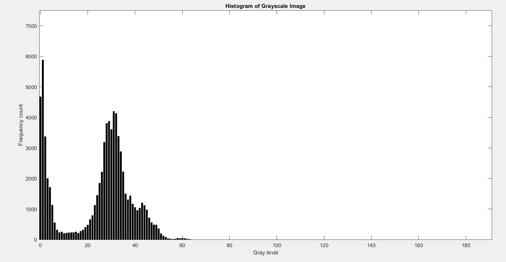
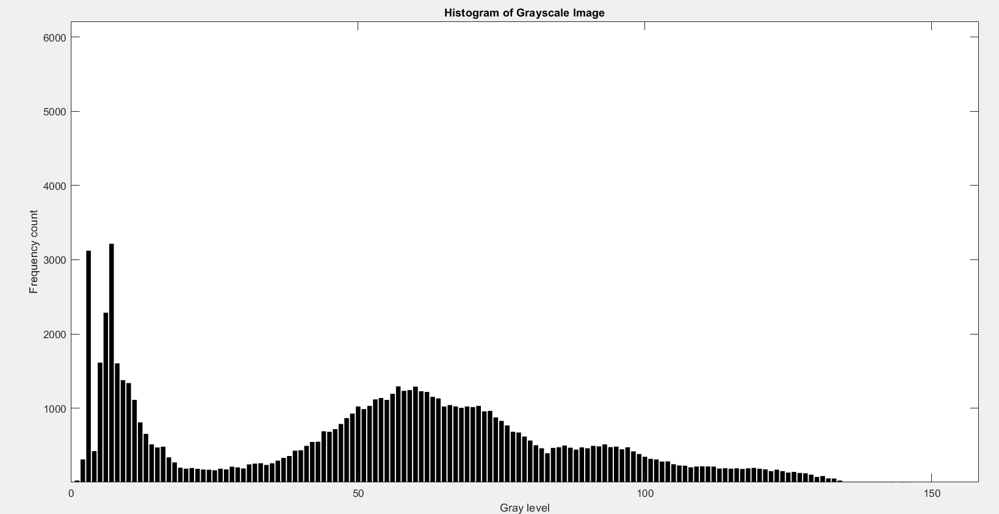
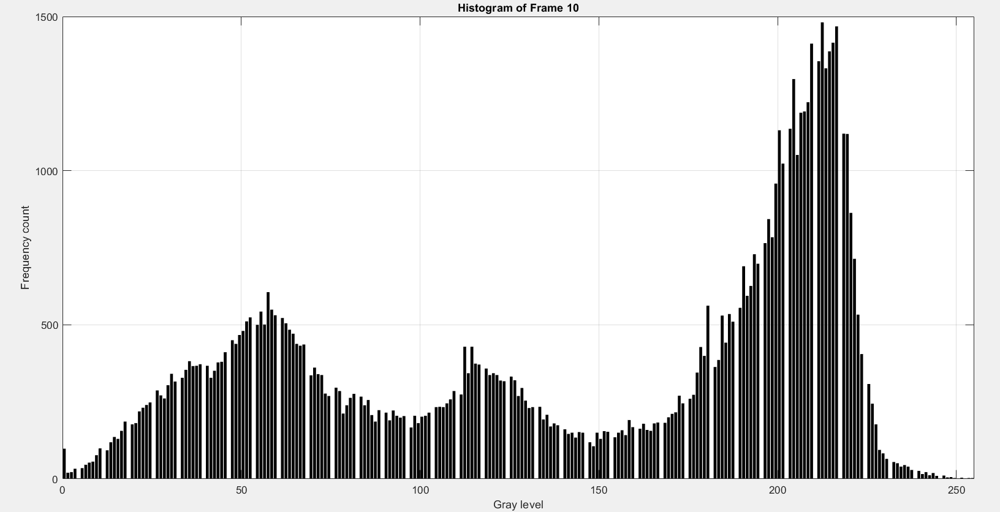
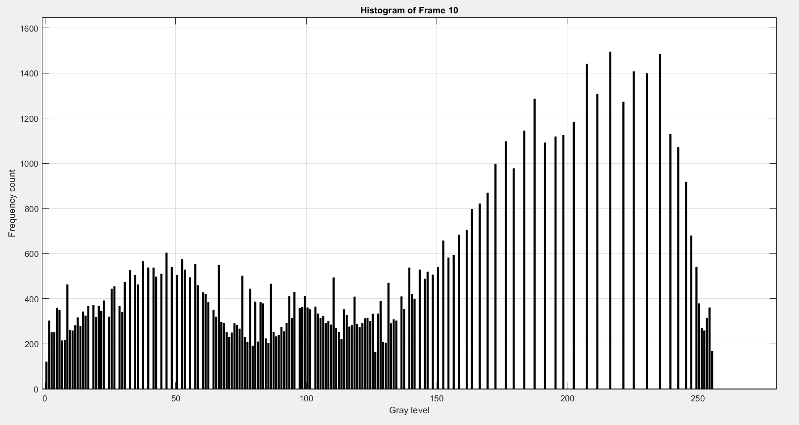
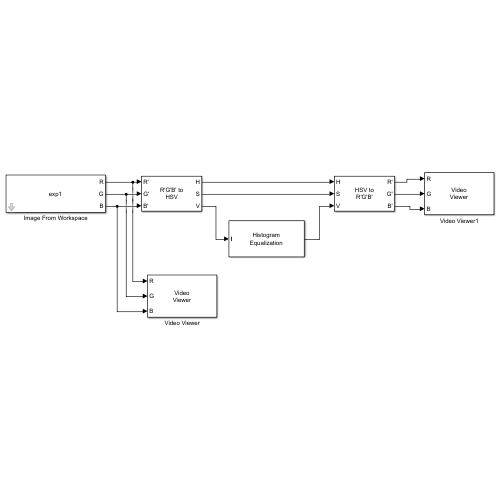
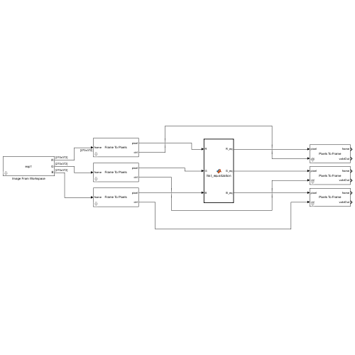
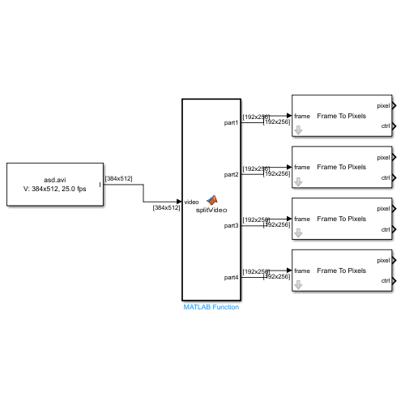
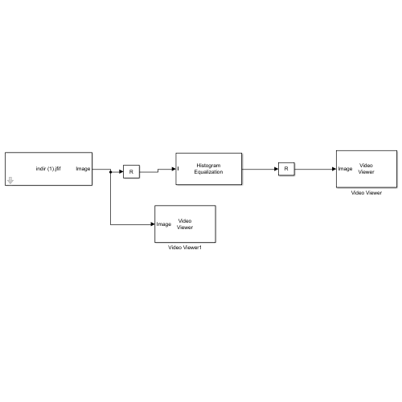
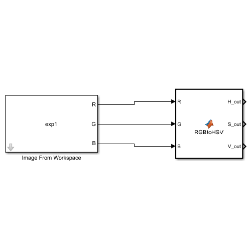

# 01 — Model-Based Design Study of Histogram Equalization & CLAHE for FPGA Implementation (B.Sc. Thesis)

**Author:** Abdullah SÖNMEZ — B.Sc. Electrical & Electronics Engineering (Dokuz Eylül University, 100% English Program)  
**Thesis Advisor:** Prof. Dr. Uğur ÇAM (`EED 4894 Final Year Project`, Grade: **AA**, June 2025)  
**Toolchain Evaluated:** MATLAB / Simulink R2024b (Vision HDL Toolbox & HDL Coder) & AMD/Xilinx Vivado v2024.2

## 1. Thesis Scope & Methodology

This repository module archives the files from my undergraduate capstone thesis (*"Model Based Design of Image Enhancement Techniques for FPGA Implementation"*). Rather than writing custom RTL from scratch, the objective of this undergraduate study was to learn and evaluate the **Model-Based Design (MBD)** workflow—starting from **MathWorks Vision HDL Toolbox reference models** in MATLAB/Simulink, validating hardware compatibility via the **HDL Coder Workflow Advisor**, generating automated **SystemVerilog (`.sv`)** code and testbenches, and running synthesis and behavioral simulation in **Xilinx Vivado v2024.2**.

Two main reference architectures were examined and simulated through this workflow:
1. **Global Histogram Equalization (HE):**
   * Evaluates 4-way spatial video partitioning (`Video Partition`), 256-bin parallel histogram accumulation (`HDLHistogram`), and cumulative distribution function (CDF) contrast stretching in Simulink, alongside HSV-domain luminance (`V`-channel) equalization models.
2. **Contrast-Limited Adaptive Histogram Equalization (CLAHE):**
   * Evaluates MathWorks' tile-based (`8 × 8` tiles) adaptive histogram equalization reference architecture (`CLAHEHDLAlgorithm`) featuring clip-limit contrast limiting and bilinear tile interpolation to enhance low-contrast and medical images without over-amplifying background noise.

## 2. Simulation & Contrast Enhancement Results

### A. Visual Contrast Enhancement (`01_clahe_input_image.jpg` vs. `02_clahe_enhanced_result.jpg`)

| Low-Contrast Input Frame | Simulink / HDL Equalized Output Frame |
| :---: | :---: |
|  |  |

### B. Grayscale Intensity Histogram Distribution (Before vs. After Equalization)

| Input Intensity Distribution (Narrow Dynamic Range) | Equalized Intensity Distribution (Expanded Dynamic Range) |
| :---: | :---: |
|  |  |

### C. HDL Simulation Histogram Verification

| HDL Stream Input Histogram | HDL Equalized Stream Output Histogram |
| :---: | :---: |
|  |  |

## 3. Evaluated Simulink Models (`./simulink_models/`)

| Simulink Model File | Model Architecture Preview | Description in Thesis Study |
| :--- | :---: | :--- |
| **`MyHistogramEqualization.slx`** |  | Baseline video-stream Histogram Equalization simulation model with dual Video Viewer comparison. |
| **`MyHistogramEqualizationForHDLCoder.slx`** |  | Pixel-stream model using Frame-to-Pixels serialization and pixel-control bus synchronization for HDL Coder checks. |
| **`MyHistogramEqualizationForHDLCoder2.slx`** |  | HSV-domain color-preserving histogram equalization model operating on the luminance (`V`) channel. |
| **`Histogram_equilization_.slx`** |  | 4-Quadrant spatial video partitioning model tested on `visionhdl_snowydays.avi`. |
| **`Histogram_equization_simulink.slx`** |  | Static image histogram equalization verification model with histogram bar-graph display. |
| **`FixedPoint_RGBtoHSV_HDLCoder.slx`** |  | Fixed-point (`ufix32, En15`) RGB-to-HSV conversion test model for HDL Coder compatibility. |

## 4. HDL Coder Generation & Xilinx Vivado v2024.2 Synthesis Inspection

After passing the pre-codegen checks in the **Simulink HDL Workflow Advisor** (32/32 checks passed for `HDLHistogram`; 29/29 passed for `CLAHE`), the automatically generated SystemVerilog source files and testbenches were imported into **Xilinx Vivado v2024.2** to inspect the resulting RTL schematics, resource utilization reports, and behavioral simulation waveforms:

| Evaluated Workflow Output | `HDLHistogram` (4-Way Parallel HE) | `CLAHEHDLAlgorithm` (8×8 Tile CLAHE) |
| :--- | :--- | :--- |
| **HDL Workflow Advisor Status** | 32 / 32 Compatibility Checks Passed | 29 / 29 Compatibility Checks Passed |
| **Generated SystemVerilog Files** | 24 `.sv` modules + `HDLHistogram_tb.sv` | 54 `.sv` modules + `CLAHEHDLAlgorithm_tb.sv` |
| **Vivado Synthesized Memory & DSPs** | 4 Dual-Port Block RAMs (`256×16-bit`), 0 DSPs | 34 Dual-Port Block RAMs, 8 DSP48E1 slices |
| **Vivado Verification Performed** | RTL schematic inspection & behavioral waveform simulation | RTL schematic inspection & behavioral waveform simulation |

## 5. Directory Structure

```text
01-FPGA-Image-Enhancement-Vivado/
├── README.md
├── docs/                                         # B.Sc. Graduation Thesis PDF (EED 4894)
├── simulink_models/                              # Evaluated Simulink (.slx) models
├── matlab_scripts/                               # Supporting MATLAB helper scripts (.m, .fig)
├── results_and_plots/                            # Input/output test images, histogram plots & test video
│   └── simulink_diagrams/                        # Block diagram screenshots of the .slx models
├── hdl_coder_reports/                            # MATLAB HDL Coder & Model Advisor HTML reports
├── rtl_systemverilog/                            # HDL Coder generated SystemVerilog (.sv) files & testbenches
└── vivado_projects/                              # Xilinx Vivado v2024.2 synthesis & simulation project files
```
