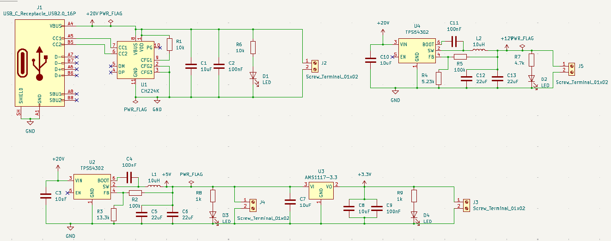
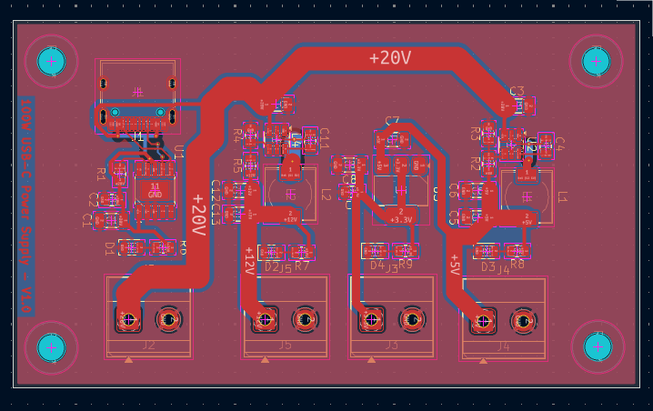
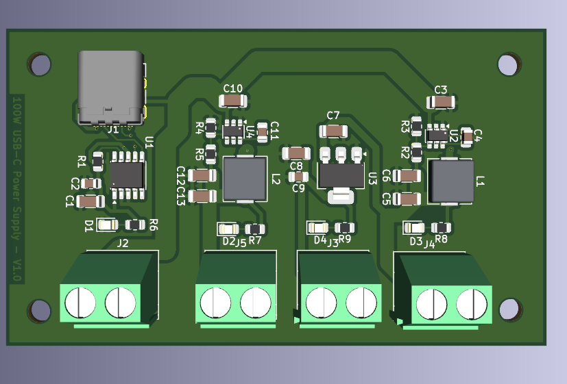
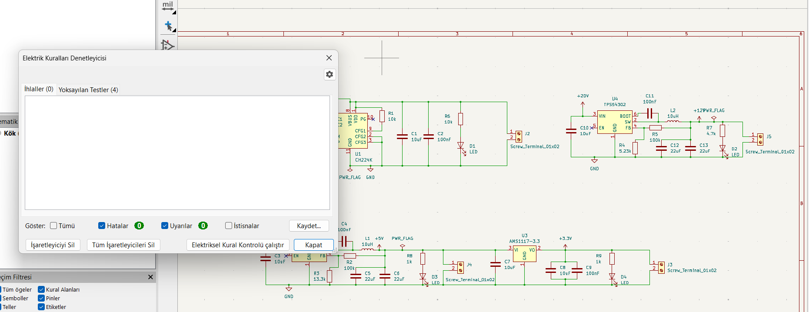

# 02 — 100W USB-C PD Multi-Rail Step-Down SMPS (`100W_USBC_PD_SMPS v1.0`)

**EDA Tool:** KiCad 10.0.4 (`Eeschema` & `Pcbnew`)  
**Board Physical Dimensions:** `46.25 mm × 78.65 mm` | **2-Layer FR4** (`1.6 mm` thickness, `35 µm / 1 oz` outer copper)  
**Verification Status:** **ERC = 0 Errors, 0 Warnings** | **DRC = 0 Errors, 0 Warnings, 0 Unconnected Items**

## 1. Project Overview

A compact, 4-rail DC-DC power distribution and synchronous step-down switched-mode power supply (SMPS) PCB designed in **KiCad**. The board negotiates a **+20V DC (up to 5A / 100W)** power profile from a USB Type-C Power Delivery (PD 3.0) source via a **`CH224K`** controller and generates four simultaneous, regulated DC output rails (**+20V, +12V, +5V, and +3.3V**) with individual status LED indicators and `5.08 mm` pitch Phoenix screw terminal blocks.

## 2. Power Stage & Rail Specifications

| Output Rail | Terminal | Regulator IC | Topology | Switching Inductor | Feedback / Config Network | Output Capacitance | Status Indicator |
| :--- | :--- | :--- | :--- | :--- | :--- | :--- | :--- |
| **+20V DC** | `J2` (`5.08 mm`) | `U1` (`CH224K`) | USB-C PD 3.0 Sink Negotiation | — | `R1 = 10 kΩ` on `CFG1` (20V PDO), `R6 = 10 kΩ` PG pull-up | `C1 = 10 µF` (`1206`), `C2 = 100 nF` (`0805`) | `D1` LED (`0805`) |
| **+12V DC (3A)** | `J5` (`5.08 mm`) | `U4` (`TPS54302`) | Synchronous Buck (~400 kHz) | `L2 = 10 µH` (`6.3×6.3×3 mm`) | `R5 = 100 kΩ` (high), `R4 = 5.23 kΩ` (low) | `C12 = 22 µF`, `C13 = 22 µF` (`1206`) | `D2` LED (`R7 = 4.7 kΩ`) |
| **+5V DC (3A)** | `J4` (`5.08 mm`) | `U2` (`TPS54302`) | Synchronous Buck (~400 kHz) | `L1 = 10 µH` (`6.3×6.3×3 mm`) | `R2 = 100 kΩ` (high), `R3 = 13.3 kΩ` (low) | `C5 = 22 µF`, `C6 = 22 µF` (`1206`) | `D3` LED (`R8 = 1 kΩ`) |
| **+3.3V DC (1A)** | `J3` (`5.08 mm`) | `U3` (`AMS1117-3.3`) | Low-Dropout Linear (LDO from +5V) | — | Fixed 3.3V internal reference | `C8 = 10 µF` (`1206`), `C9 = 100 nF` (`0805`) | `D4` LED (`R9 = 1 kΩ`) |

## 3. PCB Stackup & Manufacturing Specifications (`.gbrjob`)

| Parameter | Specification |
| :--- | :--- |
| **Board Dimensions** | `46.25 mm × 78.65 mm` |
| **Layer Count & Material** | 2 Copper Layers (`F.Cu`, `B.Cu`), FR-4 Core (`1.51 mm` dielectric, `1.60 mm` total thickness) |
| **Copper Weight** | `0.035 mm` (`35 µm` / `1 oz/ft²`) on both `F.Cu` and `B.Cu` |
| **Minimum Track Width / Clearance** | `0.25 mm` min line width, `0.20 mm` pad-to-pad / track-to-track, `0.50 mm` copper zone clearance |
| **Mounting Holes** | 4× Corner Mounting Holes |

## 4. Official Bill of Materials (`fabrication_bom_and_cpl/100W_USBC_PD_SMPS_BOM.csv`)

| Reference | Qty | Value / Part Number | KiCad Footprint | Functional Description |
| :--- | :---: | :--- | :--- | :--- |
| `J1` | 1 | `USB_C_Receptacle_USB2.0_16P` | `Connector_USB:USB_C_Receptacle_HRO_TYPE-C-31-M-12` | Primary USB Type-C PD Power Input (+20V VBUS) |
| `U1` | 1 | `CH224K` | `Package_SO:SSOP-10-1EP_3.9x4.9mm_P1mm_EP2.1x3.3mm` | USB PD 3.0 / Fast-Charge Sink Controller IC (Exposed Thermal Pad) |
| `U2, U4` | 2 | `TPS54302` | `Package_TO_SOT_SMD:SOT-23-6` | 4.5V–28V Input, 3A Synchronous Step-Down Buck Converter |
| `U3` | 1 | `AMS1117-3.3` | `Package_TO_SOT_SMD:SOT-223-3_TabPin2` | 1A Low-Dropout Linear Regulator (+5V to +3.3V) |
| `L1, L2` | 2 | `10uH` | `Inductor_SMD:L_6.3x6.3_H3` | Shielded SMD Power Inductors (`6.3 × 6.3 × 3.0 mm`) |
| `C1, C3, C7, C8, C10` | 5 | `10uF` | `Capacitor_SMD:C_1206_3216Metric` | Input/output bulk MLCC decoupling capacitors (`1206`) |
| `C5, C6, C12, C13` | 4 | `22uF` | `Capacitor_SMD:C_1206_3216Metric` | Parallel low-ESR buck output filter MLCC capacitors (`1206`) |
| `C2, C4, C9, C11` | 4 | `100nF` | `Capacitor_SMD:C_0805_2012Metric` | High-frequency decoupling & high-side MOSFET bootstrap caps (`0805`) |
| `R2, R5` | 2 | `100k` | `Resistor_SMD:R_0805_2012Metric` | Upper feedback divider resistors for `TPS54302` (`U2`, `U4`) |
| `R3` | 1 | `13.3k` | `Resistor_SMD:R_0805_2012Metric` | Lower feedback resistor for +5V rail (`U2`) |
| `R4` | 1 | `5.23k` | `Resistor_SMD:R_0805_2012Metric` | Lower feedback resistor for +12V rail (`U4`) |
| `R1, R6` | 2 | `10k` | `Resistor_SMD:R_0805_2012Metric` | `CH224K` `CFG1` 20V profile resistor (`R1`) and `PG` resistor (`R6`) |
| `R7` | 1 | `4.7k` | `Resistor_SMD:R_0805_2012Metric` | +12V rail LED current-limiting resistor |
| `R8, R9` | 2 | `1k` | `Resistor_SMD:R_0805_2012Metric` | +5V and +3.3V rail LED current-limiting resistors |
| `D1, D2, D3, D4` | 4 | `LED` | `LED_SMD:LED_0805_2012Metric` | Rail status indicator LEDs (+20V, +12V, +5V, +3.3V) |
| `J2, J3, J4, J5` | 4 | `Screw_Terminal_01x02` | `TerminalBlock_Phoenix:TerminalBlock_Phoenix_MKDS-1,5-2-5.08_1x02_P5.08mm_Horizontal` | `5.08 mm` pitch 2-Pin output terminal blocks |

## 5. Directory Structure

```text
02-100W-USBC-PD-MultiRail-SMPS-KiCad/
├── README.md
├── BOM_100W_USBC_PD_SMPS.csv
├── kicad_project/                        # Native KiCad 10.0.4 design files
│   ├── 100W_USBC_PD_SMPS.kicad_pro
│   ├── 100W_USBC_PD_SMPS.kicad_sch
│   ├── 100W_USBC_PD_SMPS.kicad_pcb
│   └── 100W_USBC_PD_SMPS.kicad_prl
├── gerber/                               # Manufacturing Gerber (.gbr), Drill (.drl) & ZIP archive
│   ├── 100W_USBC_PD_SMPS_Gerber_Package.zip
│   └── *.gbr / *.drl / *.gbrjob
├── fabrication_bom_and_cpl/              # Official KiCad BOM & Pick-and-Place XY position files
│   ├── 100W_USBC_PD_SMPS_BOM.csv
│   └── 100W_USBC_PD_SMPS_PickAndPlace_CPL.csv
└── images/                               # High-res schematic, 2D PCB, ERC, DRC & 3D renders
```

## 6. Design Gallery

### 1. Full Circuit Schematic


### 2. 2D PCB Layout & High-Current Copper Pours (`46.25 × 78.65 mm`)


### 3. 3D PCB Render (`100W USB-C Power Supply - v1.0`)


### 4. Electrical & Design Rule Verification (ERC & DRC — 0 Errors)


