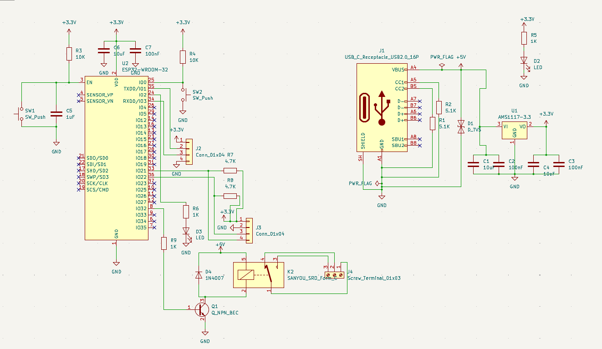
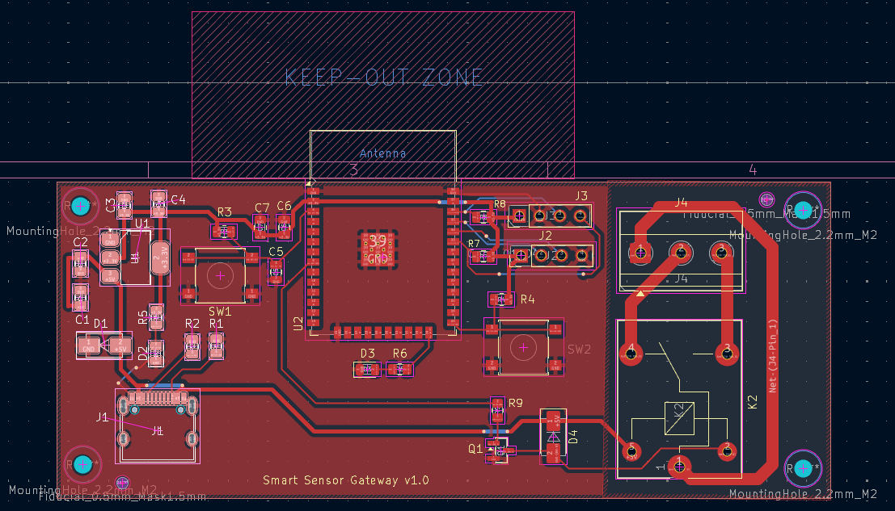
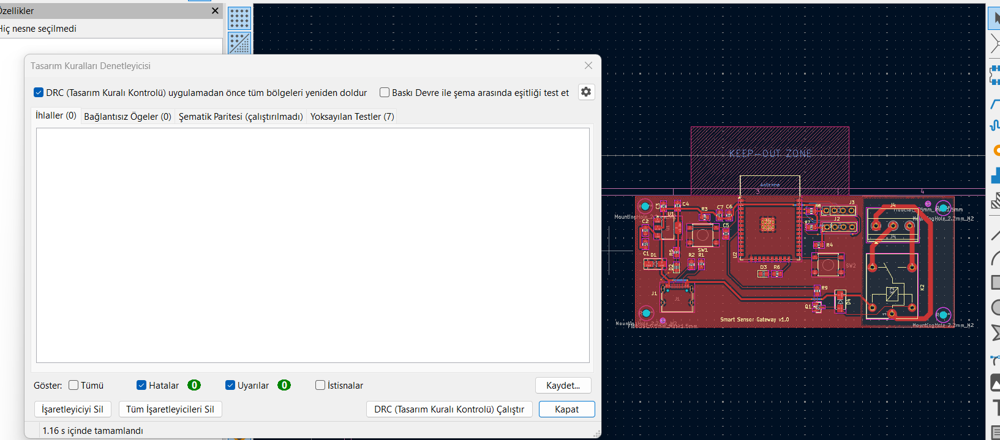
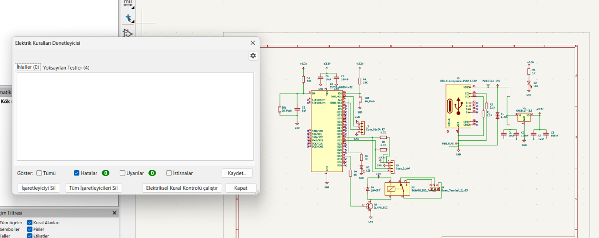

# 03 — ESP32 Industrial Smart Sensor & Actuator Gateway (`Smart_Sensor_Gateway_Rev1 / v1.0`)

**EDA Tool:** KiCad 10.0.4 (`Eeschema` & `Pcbnew`)  
**Board Physical Dimensions:** `97.05 mm × 39.80 mm` | **2-Layer FR4** (`1.6 mm` thickness, `35 µm / 1 oz` outer copper)  
**Verification Status:** **ERC = 0 Errors, 0 Warnings** | **DRC = 0 Errors, 0 Warnings, 0 Unconnected Items**

## 1. Project Overview

A custom industrial IoT (IIoT) sensor and actuator gateway PCB (`Smart_Sensor_Gateway_Rev1 / v1.0`) designed in **KiCad** around the **ESP32-WROOM-32** wireless microcontroller module. The board integrates a 16-pin USB Type-C power input with SMA transient voltage suppression (`D_TVS`), a +3.3V LDO regulator (`AMS1117-3.3`), dual 4-pin `2.54 mm` sensor expansion ports with onboard `4.7 kΩ` I2C pull-up networks, Omron `B3S-1000` SMD Reset/Boot pushbuttons, optical SMT fiducials, and an isolated electromechanical relay actuator stage (`SANYOU SRD Form-C`).

## 2. Hardware Architecture & Subsystem Specifications

| Subsystem | Key Components | Technical Implementation Details |
| :--- | :--- | :--- |
| **Wireless MCU Core** | `U2` (`ESP32-WROOM-32`) | 2.4 GHz Wi-Fi & Bluetooth/BLE dual-core MCU positioned at the top board edge with a dedicated copper-free **Antenna Keep-Out Zone** on `F.Cu` and `B.Cu`. |
| **USB-C Power & Protection** | `J1` (`HRO TYPE-C-31-M-12`), `R1, R2 = 5.1 kΩ`, `D1` (`D_TVS` SMA) | 16-pin USB-C receptacle configured as a 5V upstream sink via dual `5.1 kΩ` CC1/CC2 pull-downs and transient voltage clamping via SMA TVS diode `D1`. |
| **+3.3V Power Regulation** | `U1` (`AMS1117-3.3`), `C1, C4 = 10 µF`, `C2, C3 = 100 nF` | Low-noise +3.3V rail supplying `ESP32-WROOM-32` (`C6 = 10 µF`, `C7 = 100 nF` local decoupling) with power status LED `D2` (`R5 = 1 kΩ`). |
| **Boot & EN (Reset) Control** | `SW1` (`EN`), `R3 = 10 kΩ`, `C5 = 1 µF`; `SW2` (`IO0`), `R4 = 10 kΩ` | RC power-on reset delay network (`10 kΩ` + `1 µF`) on `EN` pin and Omron `B3S-1000` SMD tactile pushbuttons for hardware reset and bootloader entry. |
| **Digital / I2C Sensor Bus** | `J2`, `J3` (`PinHeader_1x04_P2.54mm`), `R7, R8 = 4.7 kΩ` | Dual 4-pin vertical headers (+3.3V, GND, `IO21`/SDA, `IO22`/SCL & GPIO) equipped with `4.7 kΩ` pull-up resistors. |
| **Relay Output Stage** | `K2` (`SANYOU_SRD_Form_C`), `Q1` (`SOT-23`), `D4` (`1N4007` SMA), `J4` | Low-side NPN transistor (`Q1`) driven from `IO4` via `R9 = 1 kΩ`, `1N4007` inductive flyback protection diode (`D4`), status LED (`D3`, `R6 = 1 kΩ`), and `5.08 mm` 3-pole terminal block (`J4`). |

## 3. PCB Stackup & Manufacturing Specifications (`.gbrjob`)

| Parameter | Specification |
| :--- | :--- |
| **Board Dimensions** | `97.05 mm × 39.80 mm` |
| **Layer Count & Material** | 2 Copper Layers (`F.Cu`, `B.Cu`), FR-4 Core (`1.51 mm` dielectric, `1.60 mm` total thickness) |
| **Copper Weight** | `0.035 mm` (`35 µm` / `1 oz/ft²`) on both `F.Cu` and `B.Cu` |
| **Minimum Track Width / Clearance** | `0.20 mm` min line width, `0.20 mm` pad-to-pad / track-to-track, `0.50 mm` copper zone clearance |
| **SMT Assembly Features** | 2× Optical Fiducial Markers (`Fiducial_0.5mm_Mask1.5mm`) + 4× Corner Mounting Holes (`M2 / 2.2 mm`) |

## 4. Official Bill of Materials (`fabrication_bom_and_cpl/Smart_Sensor_Gateway_Rev1_BOM.csv`)

| Reference | Qty | Value / Part Number | KiCad Footprint | Functional Description |
| :--- | :---: | :--- | :--- | :--- |
| `U2` | 1 | `ESP32-WROOM-32` | `RF_Module:ESP32-WROOM-32` | Wi-Fi + Bluetooth/BLE Dual-Core 32-Bit MCU Module |
| `U1` | 1 | `AMS1117-3.3` | `Package_TO_SOT_SMD:SOT-223-3_TabPin2` | +5V to +3.3V 1A Low-Dropout Linear Voltage Regulator |
| `J1` | 1 | `USB_C_Receptacle_USB2.0_16P` | `Connector_USB:USB_C_Receptacle_HRO_TYPE-C-31-M-12` | +5V USB Type-C Power Input Receptacle |
| `K2` | 1 | `SANYOU_SRD_Form_C` | `Relay_THT:Relay_SPDT_SANYOU_SRD_Series_Form_C` | 5V Coil SPDT (Form-C) Electromechanical Power Relay |
| `Q1` | 1 | `Q_NPN_BEC` | `Package_TO_SOT_SMD:SOT-23` | NPN Low-Side Relay Coil Driver Transistor (controlled by `IO4`) |
| `D4` | 1 | `1N4007` | `Diode_SMD:D_SMA` | Relay Coil Inductive Flyback Protection Diode (`SMA`) |
| `D1` | 1 | `D_TVS` | `Diode_SMD:D_SMA` | USB VBUS Transient Voltage Suppressor / Zener Clamp (`SMA`) |
| `D2, D3` | 2 | `LED` | `LED_SMD:LED_0805_2012Metric` | +3.3V Power LED (`D2`) and Relay Actuation Status LED (`D3`) |
| `J2, J3` | 2 | `Conn_01x04` | `Connector_PinHeader_2.54mm:PinHeader_1x04_P2.54mm_Vertical` | 4-Pin I2C / Digital Sensor Expansion Headers |
| `J4` | 1 | `Screw_Terminal_01x03` | `TerminalBlock_Phoenix:TerminalBlock_Phoenix_MKDS-1,5-3-5.08_1x03_P5.08mm_Horizontal` | `5.08 mm` Pitch 3-Pole Relay Output Screw Terminal (NO/COM/NC) |
| `SW1, SW2` | 2 | `SW_Push` | `Button_Switch_SMD:SW_SPST_B3S-1000` | Omron `B3S-1000` Hardware Reset (`EN`) & Bootloader (`IO0`) Switches |
| `R1, R2` | 2 | `5.1K` | `Resistor_SMD:R_0805_2012Metric` | USB-C `CC1` & `CC2` Host/DFP Pull-Down Resistors (`0805`) |
| `R3, R4` | 2 | `10K` | `Resistor_SMD:R_0805_2012Metric` | `EN` and `IO0` Pull-Up Resistors (`0805`) |
| `R7, R8` | 2 | `4.7K` | `Resistor_SMD:R_0805_2012Metric` | I2C Bus (`IO21` / `IO22`) Pull-Up Resistors (`0805`) |
| `R5, R6, R9` | 3 | `1K` | `Resistor_SMD:R_0805_2012Metric` | LED Current Limiters (`R5`, `R6`) & Transistor Base Resistor (`R9`) |
| `C1, C4, C6` | 3 | `10uF` | `Capacitor_SMD:C_0805_2012Metric` | LDO Input/Output and ESP32 VDD Bulk Decoupling Capacitors (`0805`) |
| `C2, C3, C7` | 3 | `100nF` | `Capacitor_SMD:C_0805_2012Metric` | High-Frequency Ceramic Bypass Capacitors (`0805`) |
| `C5` | 1 | `1uF` | `Capacitor_SMD:C_0805_2012Metric` | `EN` Pin Power-On Reset RC Delay Capacitor (`0805`) |

## 5. Directory Structure

```text
03-ESP32-Smart-Sensor-Gateway-KiCad/
├── README.md
├── BOM_ESP32_Smart_Sensor_Gateway.csv
├── kicad_project/                        # Native KiCad 10.0.4 design files
│   ├── Smart_Sensor_Gateway_Rev1.kicad_pro
│   ├── Smart_Sensor_Gateway_Rev1.kicad_sch
│   ├── Smart_Sensor_Gateway_Rev1.kicad_pcb
│   └── Smart_Sensor_Gateway_Rev1.kicad_prl
├── gerber/                               # Manufacturing Gerber (.gtl/.gbl), Drill (.drl) & ZIP archive
│   ├── Smart_Sensor_Gateway_Rev1_Gerber_Package.zip
│   └── *.gtl / *.gbl / *.drl / *.gbrjob
├── fabrication_bom_and_cpl/              # Official KiCad BOM & Pick-and-Place XY position files
│   ├── Smart_Sensor_Gateway_Rev1_BOM.csv
│   └── Smart_Sensor_Gateway_Rev1_PickAndPlace_CPL.csv
└── images/                               # High-res schematic, 2D PCB, DRC, ERC & 3D renders
```

## 6. Design Gallery

### 1. Full Circuit Schematic


### 2. 2D PCB Layout & Antenna Keep-Out Zone (`97.05 × 39.80 mm`)


### 3. 3D PCB Render (`Smart Sensor Gateway v1.0`)


### 4. Design & Electrical Rule Verification (DRC & ERC — 0 Errors)


