# 04 — Industrial Induction Heating Power Electronics & Gate Drive Commissioning (`Mahes Machine`)

## Engineering Scope & Industrial Field Archive
This directory documents hands-on power electronics hardware engineering, board-level troubleshooting, IGBT gate-drive waveform verification, dip-soldering/conformal coating production, and full-cabinet electromechanical integration performed on **Mahes Machine (`MAHES Induction Heating Technologies`)** industrial resonant induction heating systems.

## Integrated Circuit (IC) & Power Semiconductor Analysis Table

During board-level analysis, commissioning, and fault diagnosis of the **Frequency Control Board (`MHS-PCB18-R1`)**, **Front Display/Control Card (`Ekran Kartı`)**, and **IGBT Trigger/Gate Driver Boards (`MHS-PCB16` / `HS-PCB06`)**, the following integrated circuits and power modules were mapped and analyzed:

### A. Frequency & Resonant Control Board (`MHS-PCB18-R1` — Frekans Kartı)

| PCB Designator | Part Number | Device Category | Technology / Package | Functional Role in Induction Heating Inverter |
| :--- | :--- | :--- | :--- | :--- |
| **`U3`** | **`TL084`** | Quad Operational Amplifier | JFET-Input Op-Amp (DIP-14) | High slew-rate ($13\text{ V/}\mu\text{s}$), low-input-bias-current analog signal conditioning, resonant tank phase-error amplification, and active filtering. |
| **`U18`** | **`CD4081B` (`4081`)** | Quad 2-Input AND Gate | High-Voltage CMOS (DIP-14) | Hardware PWM enable/interlock gating; combines oscillator pulses with fault-clear signals so IGBT drive is immediately inhibited under fault conditions. |
| **`U7`** | **`CD40106B` (`40106`)** | Hex Schmitt-Trigger Inverter | High-Voltage CMOS (DIP-14) | Hysteresis-based waveform squaring of resonant zero-crossing feedback signals, RC dead-time delay generation, and switching noise immunity in high-$dV/dt$ environments. |
| **`U4`** | **`CD4093B` (`4093`)** | Quad 2-Input NAND Schmitt Trigger | High-Voltage CMOS (DIP-14) | High-noise-immunity gated pulse conditioning, dead-time interlock logic, and fault latch control between the resonant PLL loop and the gate driver output stage. |

### B. Front Panel Display, Protection & Control Board (`Ekran Kartı`)

| PCB Designator | Part Number | Device Category | Technology / Package | Functional Role in Induction Heating Inverter |
| :--- | :--- | :--- | :--- | :--- |
| **`U16`** | **`LM324`** | Quad Operational Amplifier | Bipolar Op-Amp (DIP-14) | Multi-channel DC/low-frequency analog scaling and buffering for DC-link voltage, current transformer (`CT`) feedback, and front-panel analog/LED bargraph metering. |
| **`U6`** | **`CA3140`** | BiMOS Operational Amplifier | MOSFET-Input / Bipolar-Output (DIP-8) | Ultra-high input impedance ($1.5\text{ T}\Omega$) buffer and integrator stage for precision current/frequency setpoint tracking without loading high-impedance sensor networks. |
| **`U1`** | **`TL084`** | Quad Operational Amplifier | JFET-Input Op-Amp (DIP-14) | Fast analog feedback conditioning and closed-loop constant-current / constant-power regulation amplifier stage. |
| **`U23`** | **`TL084`** | Quad Operational Amplifier | JFET-Input Op-Amp (DIP-14) | Secondary active filter and instrumentation scaling stage for resonant tank voltage and thermal/protection feedback channels. |
| **`U5`** | **`LM393`** | Dual Differential Comparator | Open-Collector Comparator (DIP-8) | Fast hardware over-current (`Aşırı Akım`), over-voltage (`Yüksek Voltaj`), water-cooling pressure (`Su Alarm`), and resonant limit window comparator triggering immediate trip latches. |
| **`U17`** | **`CD40106B` (`40106`)** | Hex Schmitt-Trigger Inverter | High-Voltage CMOS (DIP-14) | Front-panel operator switch debouncing (`Start`/`Stop`, `Man`/`Oto`, `Sabit Akım`/`Pot`), alarm LED logic inversion, and noise-immune digital interfacing. |
| **`U2`** | **`LM566`** | Voltage-Controlled Oscillator (VCO) | Analog VCO IC (DIP-8) | Converts the analog control/error voltage (from manual potentiometer or closed-loop regulator) into a linear frequency-modulated square/triangle wave to sweep and lock onto the induction work-coil resonant tank frequency. |

### C. IGBT Gate Driver (`MHS-PCB16` / `HS-PCB06`) & High-Power Inverter Stage

| Designator / Board | Part Number | Device Category | Key Ratings & Architecture | Functional Role in Induction Heating Inverter |
| :--- | :--- | :--- | :--- | :--- |
| **`MHS-PCB16` Hybrid IC** | **`VLA567-11R`** | Hybrid Dual IGBT Gate Driver | Isahaya/Powerex Hybrid IC (`2500 Vrms` opto-isolation, bipolar $+15\text{V}/-8\text{V}$ gate drive) | Drives high-capacity half-bridge IGBT modules with isolated floating gate supplies, high peak gate current, and built-incollector-emitter desaturation ($V_{CE(sat)}$) short-circuit protection. |
| **Power Switch Module** | **`2MBI600...` Series** | Dual Half-Bridge IGBT Module | `600 A` / `600V–1200V` Industrial Dual IGBT Brick | High-current H-bridge / half-bridge resonant inverter power switches mounted on water-cooled heat-exchanger plates and laminated copper busbars with axial film snubber capacitors. |

## Hardware Testing, Troubleshooting & Production Workflow

### 1. Control & Frequency Boards (`01-Control-and-Frequency-Boards/`)
* Complete inspection and functional verification of the `MHS-PCB18-R1` frequency board and front-panel operator unit (`MAHES Induction Heating Technologies` HMI featuring digital display, `Start/Stop`, `On/Off`, `Man/Oto`, `Sabit Akım/Pot` mode selectors, and fault indicators for *Aşırı Frekans, Yüksek Voltaj, Aşırı Akım, Su Alarm, Kapak Alarm, Faz Alarm, Sıcaklık Alarm*).

| Frequency Board (`MHS-PCB18-R1`) | Front Control Panel HMI |
| :---: | :---: |
| 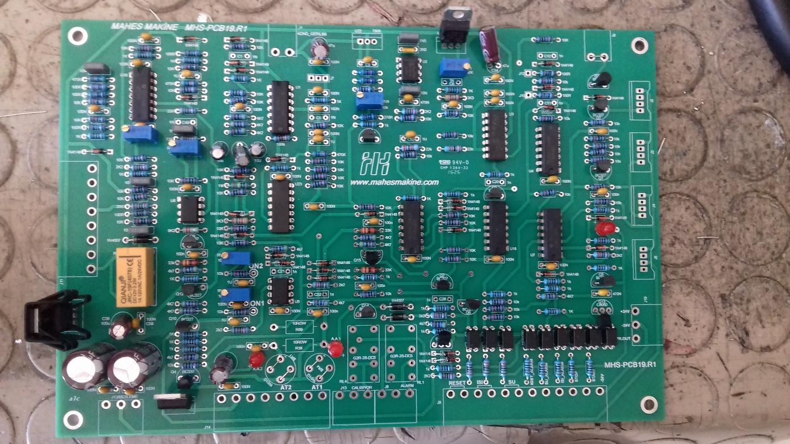 | 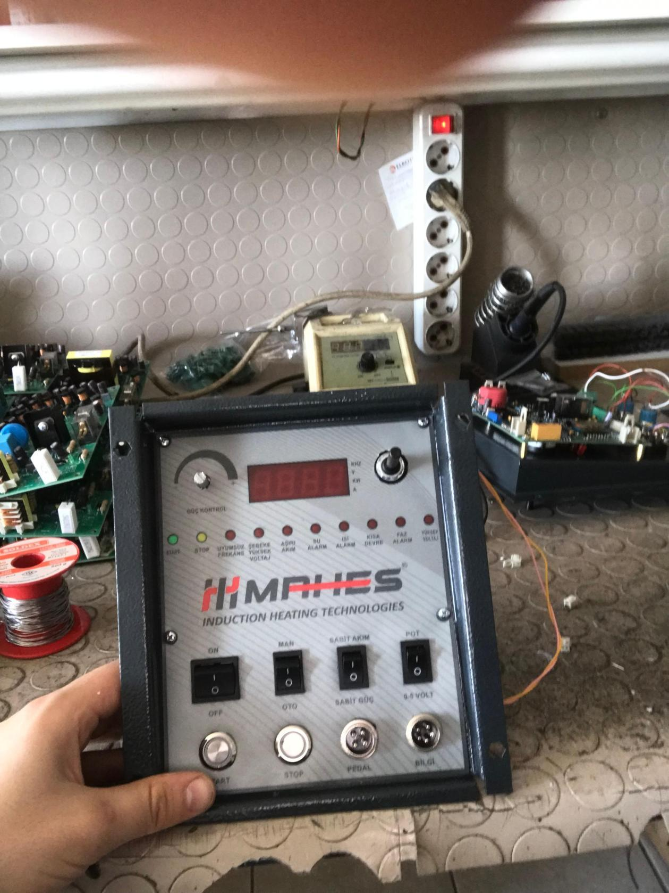 |

### 2. Blown IGBT Replacement & Gate Drive Oscilloscope Verification (`02-IGBT-Gate-Driver-and-Oscilloscope-Tests/`)
* **Failure Diagnosis & Repair:** Replaced shorted/damaged `600A` dual IGBT power bricks and refurbished the `MHS-PCB16` (`VLA567-11R`) and `HS-PCB06` gate trigger boards.
* **Gate-Emitter (`V_GE`) Waveform Verification:** Before applying high DC-link bus voltage, gate-to-emitter drive waveforms were probed directly across the IGBT gate terminals under variable frequency sweep:
  * **Analog Oscilloscope (`MOS-620 20 MHz`):** Verified clean rise/fall edges, negative turn-off bias (preventing $dV/dt$-induced parasitic Miller turn-on), and dead-time symmetry.
  * **Digital Storage Oscilloscope (`Tektronix TDS 210`):** Verified stable **27.72 kHz** square-wave gate drive (`CH1 5.00V`, `CH2 5.00V`, `M 50µs`) across the full potentiometer control range.

| `MHS-PCB16` Top Side | `VLA567-11R` Hybrid Driver Bottom Side |
| :---: | :---: |
| 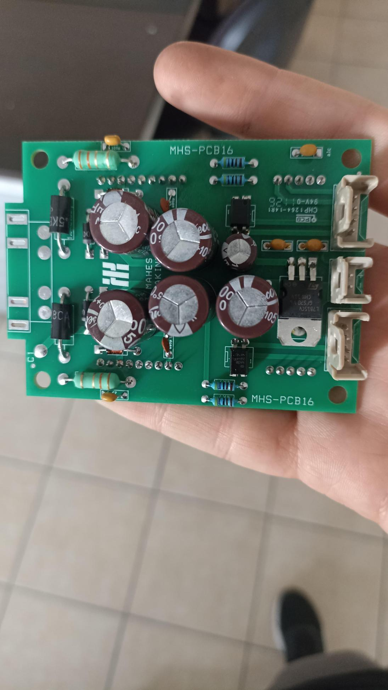 | 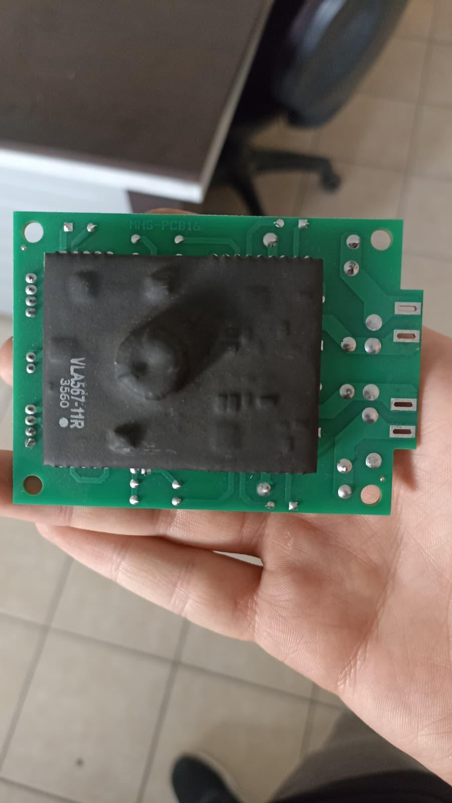 |

| IGBT Module Bench Probing (`27.72 kHz`) | `MOS-620` Gate Pulse Verification |
| :---: | :---: |
| 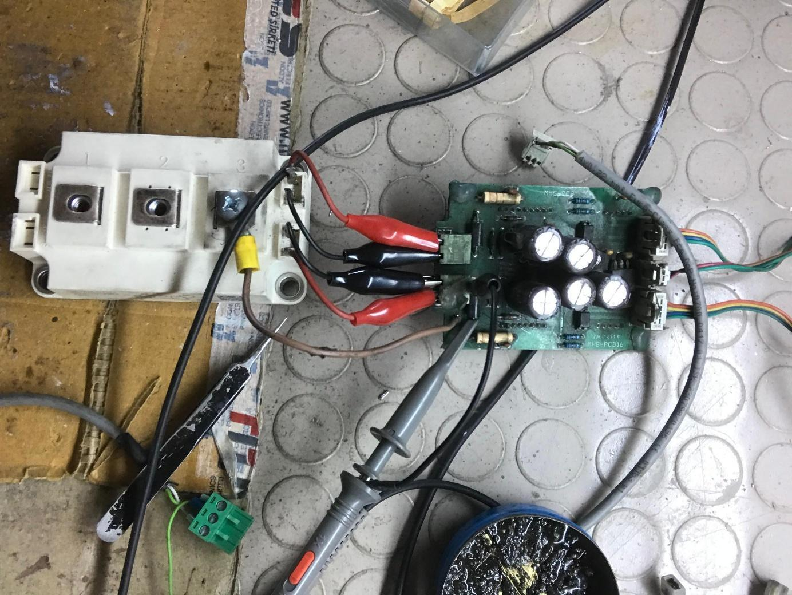 | 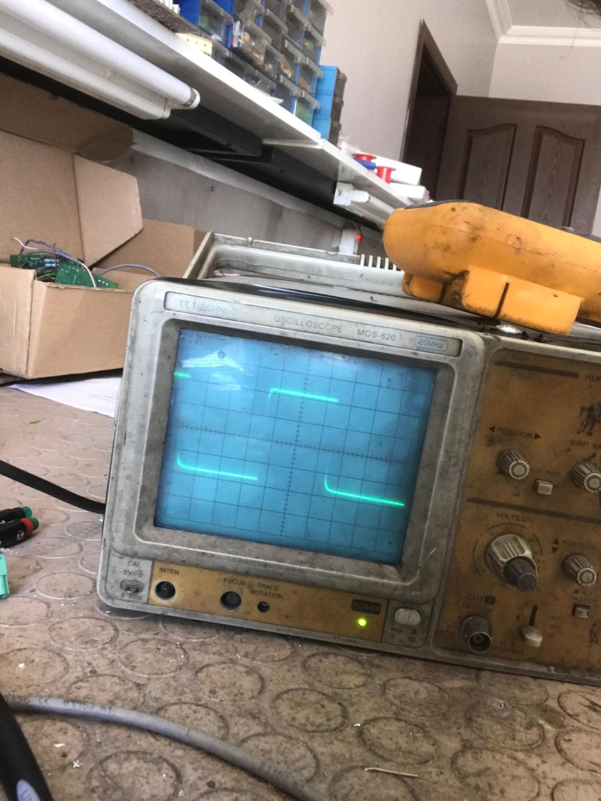 |

### 3. Industrial Cabinet & Water-Cooled Power Stage Integration (`03-Cabinet-and-Power-Stage-Assembly/`)
* Electromechanical assembly of the complete induction heating cabinet:
  * **Upper Control Bay:** DIN-rail auxiliary power supplies (`XP540`), control/relay interface boards, and `MHS-PCB18-R1` frequency controller.
  * **Mid Power Inverter Bay:** Parallel array of 4× `MHS-PCB16` IGBT trigger boards driving 4× parallel high-power IGBT modules with low-inductance white polypropylene snubber blocks across the busbars.
  * **Left Capacitor Bank & Lower Cooling Manifold:** High-current resonant tank capacitor bank (`12×` water-cooled/heavy-duty busbar terminals), high-frequency output isolation/matching transformer, and multi-channel red/blue hydraulic water-cooling manifold for thermal management.

| Full Internal Power Cabinet Architecture | Quad IGBT Driver & Snubber Bank | Water-Cooled Manifold & Transformer |
| :---: | :---: | :---: |
| 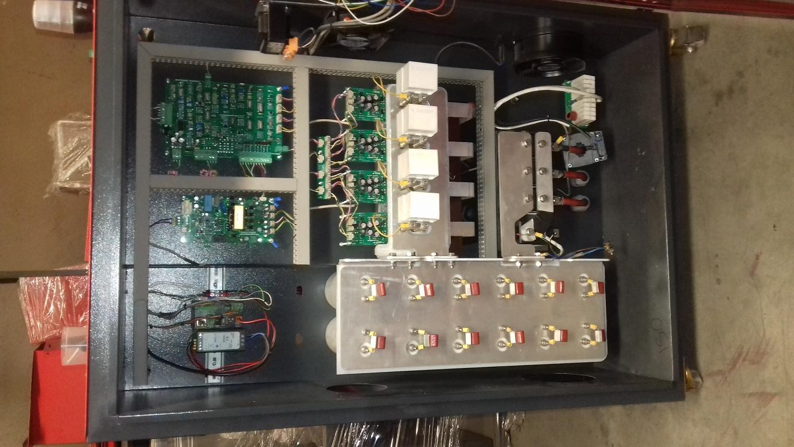 | 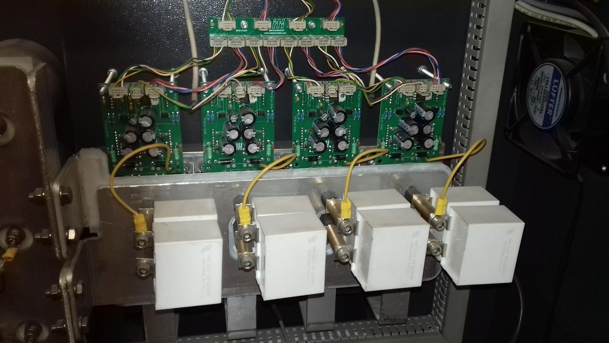 | 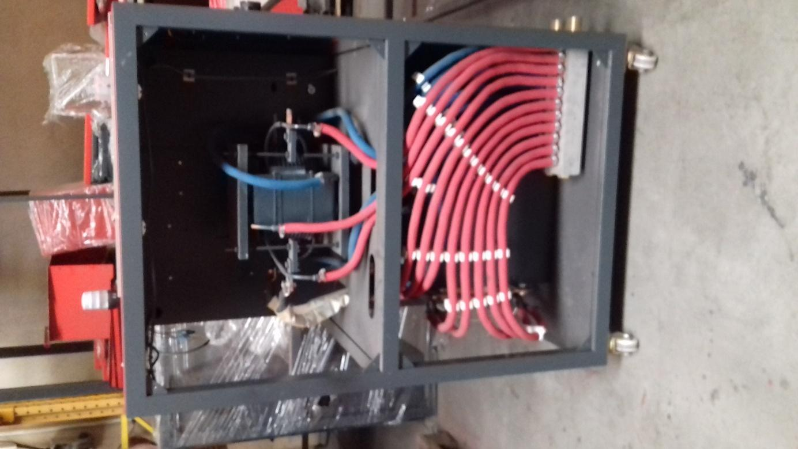 |

### 4. Batch PCB Production, Solder Pot Dip-Soldering & Conformal Coating (`04-Production-Soldering-and-Coating/`)
* **Thermal Solder Pot (`Lehim Potası`) Operation:** Performed batch through-hole soldering of heavy-duty connectors, electrolytic capacitor banks, and hybrid gate drivers (`MHS-PCB16`) using a temperature-controlled industrial molten solder bath.
* **Protective Conformal Coating (`Koruyucu Vernikleme`):** Applied protective insulating lacquer/varnish across assembled trigger boards to safeguard high-impedance gate drive circuits against industrial metal dust, humidity, and high-voltage arcing.

| Batch Assembled `MHS-PCB16` Trigger Boards | Thermal Solder Pot Dip-Soldering | Conformal Coating Application |
| :---: | :---: | :---: |
| 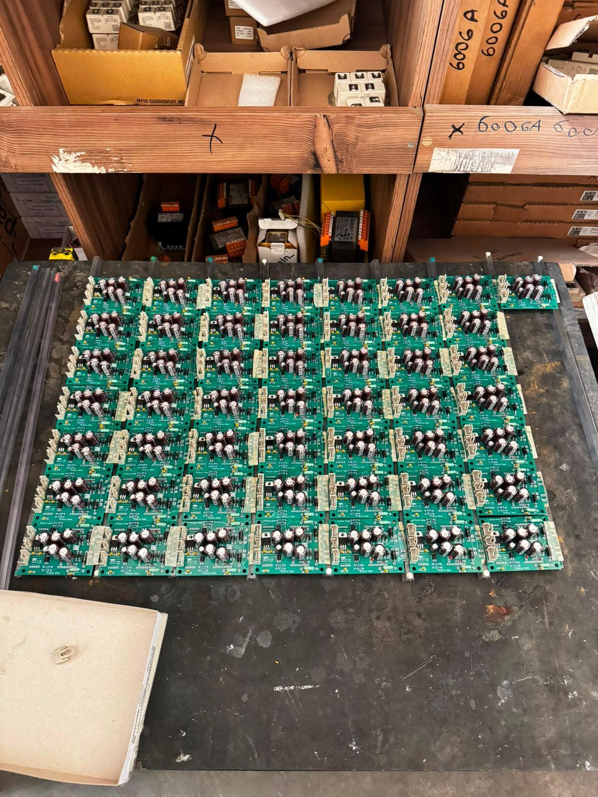 | 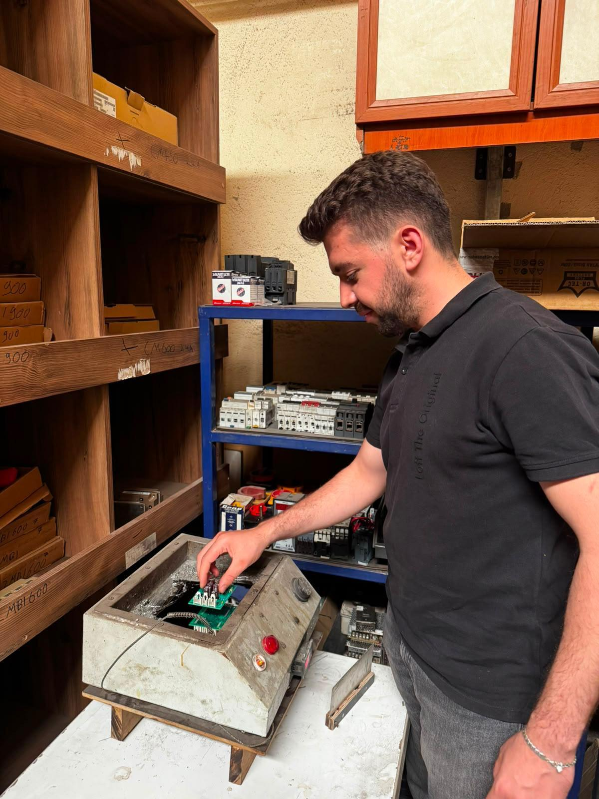 | 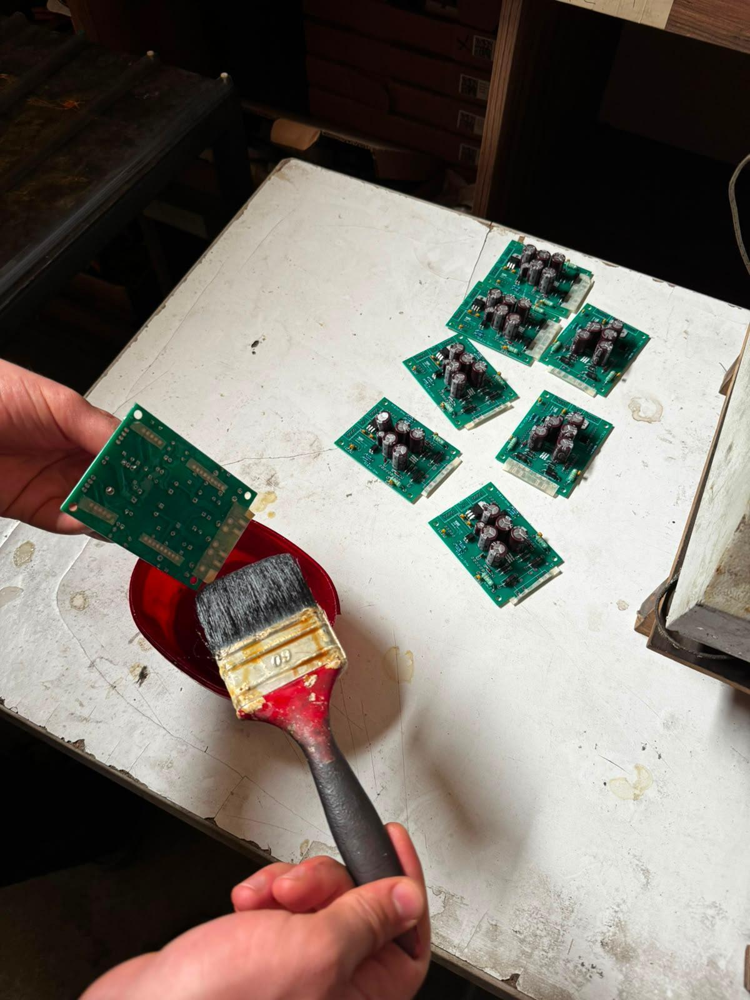 |
