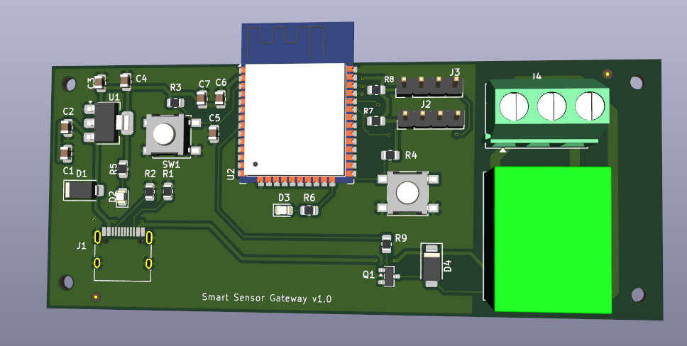
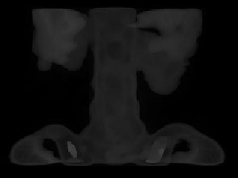
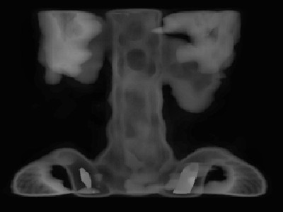
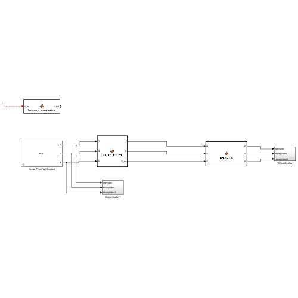

# Hardware, Power Electronics & PCB Engineering Portfolio

**Author:** Abdullah SÖNMEZ — Electrical & Electronics Engineer (B.Sc., Dokuz Eylül University, 100% English Program) & Mechatronics A.S. (Graduated 3rd in Department, Necmettin Erbakan University)  
**Focus Areas:** Industrial Power Electronics & Resonant Induction Heating, 600A IGBT Gate Drivers & Oscilloscope Diagnostics, Multi-Rail DC-DC SMPS & Sensor Interface PCB Design (KiCad), Model-Based Simulink-to-Vivado HDL Workflow  
**Contact:** [snmz42snmz@gmail.com](mailto:snmz42snmz@gmail.com) | **GitHub:** [github.com/abdullahssonmez](https://github.com/abdullahssonmez)  
**Full Portfolio & CV (PDF):** [`Abdullah_Sonmez_CV_and_Hardware_Portfolio.pdf`](./Abdullah_Sonmez_CV_and_Hardware_Portfolio.pdf)

## Portfolio Architecture Overview

This technical archive consolidates my industrial power electronics work, custom KiCad PCB layouts, and undergraduate B.Sc. thesis files into a single structured repository. Each module contains schematics, PCB layouts, design verification reports (ERC/DRC), hardware bench test waveforms, component-level IC analyses, and simulation files.

| Module | Project Directory | Core Technologies & Hardware Targets | Key Deliverables Included |
| :--- | :--- | :--- | :--- |
| **01** | [`01-FPGA-Image-Enhancement-Vivado`](./01-FPGA-Image-Enhancement-Vivado) | MATLAB/Simulink R2024b (Vision HDL Toolbox & HDL Coder), SystemVerilog (`.sv`), Xilinx Vivado v2024.2 | B.Sc. Thesis PDF (*Grade: AA*), Simulink reference models (`.slx`), HDL Coder reports, Vivado simulation projects & before/after histogram plots |
| **02** | [`02-100W-USBC-PD-MultiRail-SMPS-KiCad`](./02-100W-USBC-PD-MultiRail-SMPS-KiCad) | `CH224K` (USB-C PD 20V), 2× `TPS54302` (+12V & +5V Buck), `AMS1117-3.3` | KiCad `.kicad_sch`, `.kicad_pcb`, Gerber fabrication files, BOM CSV, ERC/DRC reports (0 errors) & 3D renders |
| **03** | [`03-ESP32-Smart-Sensor-Gateway-KiCad`](./03-ESP32-Smart-Sensor-Gateway-KiCad) | `ESP32-WROOM-32`, `AMS1117-3.3`, USB-C 5V, `SANYOU SRD` Relay, I2C | KiCad `.kicad_sch`, `.kicad_pcb`, Gerber fabrication files, BOM CSV, RF Keep-Out layout, ERC/DRC & 3D renders |
| **04** | [`04-Industrial-Induction-Heating-Power-Electronics`](./04-Industrial-Induction-Heating-Power-Electronics) | `VLA567-11R` Gate Driver, `2MBI600` 600A IGBT, `TL084`, `LM566`, `CA3140`, `CD40106` | 35 high-res bench/cabinet photos, 27.72 kHz oscilloscope gate waveforms, IC functional analysis table & dip-soldering logs |

## Project Highlights & Visual Previews

### 1. Industrial Induction Heating Power Electronics (`04-Industrial-Induction-Heating-Power-Electronics`)
* **Hands-On Industrial Hardware & Production Engineering (Mahes Machine):** Participated in end-to-end electromechanical cabinet assembly, water-cooled copper busbar integration, PCB molten solder-pot dip soldering, conformal coating, board-level IC diagnostics, blown IGBT module replacement (`Fuji 2MBI600` 600A series), and high-frequency gate driver testing.
* **Gate Drive Waveform Verification:** Verified clean bipolar square-wave gate-emitter (`V_GE`) switching pulses at **27.72 kHz** on `MHS-PCB16` (`VLA567-11R` hybrid isolated gate driver with `1.5KE` TVS protection) using `Tektronix TDS 210` digital and `MOS-620` analog oscilloscopes.

### 2. 100W USB-C PD Multi-Rail Step-Down SMPS (`02-100W-USBC-PD-MultiRail-SMPS-KiCad`)
* **Power Input:** USB Type-C PD 3.0 sink interface (`J1`) controlled by a `CH224K` (`U1`) negotiating a **+20V DC** (up to 5A / 100W) bus rail.
* **Multi-Rail Architecture:** Direct **+20V** bus (`J2`), **+12V / 3A** synchronous buck stage (`U4` - `TPS54302`, `L2 = 10 µH`, `R5 = 100 kΩ / R4 = 5.23 kΩ`), **+5V / 3A** synchronous buck stage (`U2` - `TPS54302`, `L1 = 10 µH`, `R2 = 100 kΩ / R3 = 13.3 kΩ`), and **+3.3V / 1A** LDO stage (`U3` - `AMS1117-3.3`).
* **Design Rule Verification:** Passed both KiCad **ERC (0 Errors, 0 Warnings)** and **DRC (0 Errors, 0 Warnings, 0 Unconnected Nets)**.

### 3. ESP32 Industrial Smart Sensor & Actuator Gateway (`03-ESP32-Smart-Sensor-Gateway-KiCad`)
* **Core Wireless MCU:** `ESP32-WROOM-32` (`U2`) dual-core Wi-Fi / BLE module routed with a strict copper-free **Antenna Keep-Out Zone** on the PCB edge.
* **USB-C Power & Industrial I/O:** 16-pin USB-C input (`J1`) with `5.1 kΩ` CC1/CC2 pull-downs (`R1`, `R2`), SMA TVS diode protection (`D1`), `AMS1117-3.3` (`U1`) LDO, dual 4-pin I2C/digital sensor headers (`J2`, `J3` with `4.7 kΩ` pull-ups `R7`, `R8`), and an onboard electromechanical relay actuator stage (`K2` - `SANYOU_SRD_Form_C`, NPN driver `Q1`, `1N4007` flyback diode `D4`, status LED `D3`, and 3-pole terminal `J4`).

### 4. Model-Based HDL Workflow Study for Image Enhancement (`01-FPGA-Image-Enhancement-Vivado`)
* **Undergraduate Capstone Thesis (`EED 4894`, Grade: AA, Advisor: Prof. Dr. Uğur Çam):** Investigated the model-based FPGA design flow by configuring and evaluating **MathWorks Vision HDL Toolbox reference architectures** for **Global Histogram Equalization (HE)** and **Contrast-Limited Adaptive Histogram Equalization (CLAHE)** in MATLAB/Simulink.
* **Automated Code Generation & Vivado Simulation:** Executed the **MATLAB HDL Coder Workflow Advisor** to automatically generate SystemVerilog (`.sv`) RTL and testbenches from the Simulink models, and imported the generated files into **Xilinx Vivado v2024.2** to inspect synthesized RTL schematics, FPGA resource utilization reports, and behavioral simulation waveforms.

| Low-Contrast Input Image | CLAHE / HE Output | Simulink HDL Model |
| :---: | :---: | :---: |
|  |  |  |
